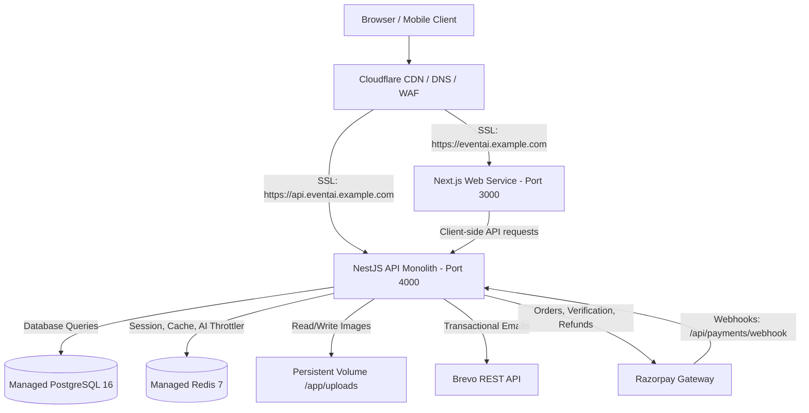
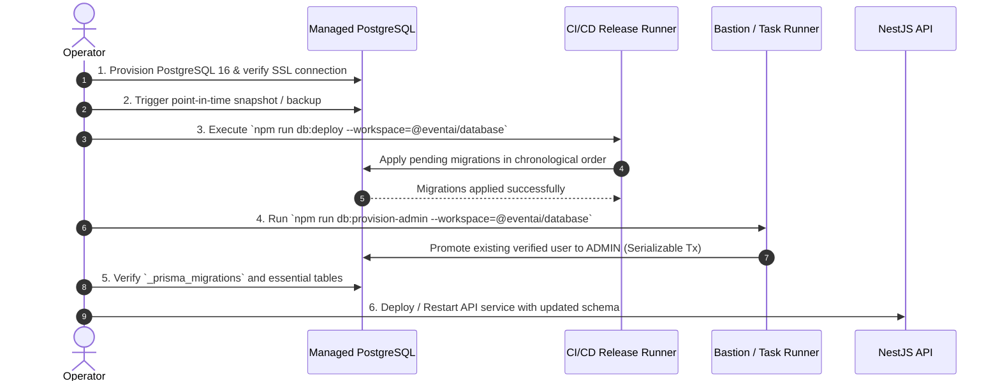
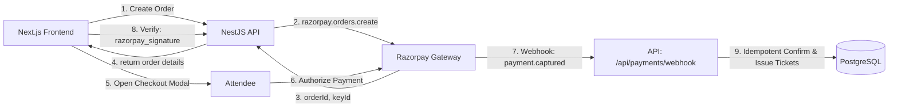

# EventAI — Phase 4: Production Deployment Plan & Launch Runbook

This document defines the production deployment plan, configuration matrix, database release procedures, payment launch checklist, and rollback runbooks for the EventAI platform.

---

## 1. Executive Summary & Current State

- **Monorepo Structure**:
  - `apps/web`: Next.js 14 frontend (standalone output, client & server components, Leaflet maps, Sentry integration).
  - `apps/api`: NestJS 10 backend monolith (Express adapter, raw body webhook parser, Prisma 6 ORM, Redis caching/throttling, scheduled cron jobs, Sentry error monitoring).
  - `apps/worker`: BullMQ background job skeleton. *Design note*: Intentionally not deployed separately in this phase; all background tasks (minute seat-hold expiration cron, email delivery, QR code generation, payment confirmation) run in-process within the API monolith.
  - `packages/database`: Prisma schema, 7 migrations, database client, and one-time admin bootstrap script.
  - `packages/types`, `packages/validation`, `packages/config`: Shared monorepo packages.
- **Baseline Quality Metrics**:
  - Unit/integration test suite: 378 passing tests across 23 test suites in `apps/api`.
  - Workspace type-check: 12 tasks passed across all 7 workspaces.
  - Production build: Passing cleanly (Next.js standalone output: 24 routes; NestJS API: dist bundle verified).
- **Core Strategy**: Deploy a high-reliability, low-overhead containerized stack with strict staging/production separation.

---

## 2. Deployment Architecture Evaluation & Recommendations

### 2.1 File Upload & Ephemeral Storage Architecture (Critical Finding)

**Code Inspection Finding**:
- `EventMediaService` (`apps/api/src/modules/events/event-media.service.ts`) and `UsersService` (`apps/api/src/modules/users/users.service.ts`) write uploaded cover images and avatars directly to the local filesystem using `UPLOAD_DIR` (defaults to `./uploads`).
- `main.ts` serves these assets statically via `app.useStaticAssets(uploadDir, { prefix: '/uploads' })`.
- `apps/web/next.config.mjs` configures a Next.js rewrite from `/uploads/:path*` to `${backendOrigin}/uploads/:path*`.

**Ephemeral Hosting Failure Mode**:
Standard container platforms (Render, Railway, AWS App Runner, ECS Fargate without EFS, Fly.io without volumes) treat local disk storage as ephemeral. When an API container restarts, scales, or redeploys:
1. All user-uploaded event banners and profile avatars are permanently wiped.
2. In a multi-container scaled cluster, an image uploaded to Container A returns HTTP 404 if the subsequent browser request is routed to Container B.

**Architectural Solutions**:
- **Phase 4 Launch Recommendation (Immediate / Zero Code Mutation)**:
  - Mount a **Persistent Volume** to `/app/uploads` (supported natively by Railway Volumes, Render Disks, DigitalOcean App Platform Volumes, or AWS ECS with EFS).
  - Maintain a **single API instance** in Staging and Initial Production until object storage is introduced, eliminating cross-instance file discrepancies.
- **Post-Launch Recommendation (Milestone 5 Refactoring)**:
  - Refactor `EventMediaService` and `UsersService` to stream uploads directly to an S3-compatible object store (e.g., Cloudflare R2, AWS S3, or Supabase Storage) and return signed or public CDN URLs.

---

### 2.2 Architecture Comparison



#### Option A: Low-Cost / Low-Ops Architecture (Recommended for Initial Launch)
- **Frontend Hosting**: **Vercel** (or Railway / Render Web Service running `docker/web.Dockerfile`).
  - *Pros*: Native Next.js SSR/ISR support, automatic Edge CDN, preview deployments, zero server maintenance.
  - *Cost*: ~$0 - $20/month.
- **Backend API Hosting**: **Railway** or **Render** running `docker/api.Dockerfile`.
  - *Configuration*: Single container instance with an attached **Persistent Disk** (10 GB) mounted at `/app/uploads`.
  - *Pros*: Multi-stage Docker build already checked in, built-in TLS, automated rollbacks, integrated log streaming.
  - *Cost*: ~$7 - $25/month.
- **Database**: **Neon** or **Render Managed PostgreSQL 16** (or Supabase).
  - *Pros*: Automated backups, connection pooling, zero infrastructure patching.
  - *Cost*: ~$0 - $25/month.
- **Cache**: **Upstash Redis** (Serverless) or **Render Managed Redis 7**.
  - *Pros*: Fully managed, pay-per-request or fixed tier, supports TLS (`rediss://`).
  - *Cost*: ~$0 - $10/month.
- **Total Estimated Cost**: ~$20 - $70/month.

#### Option B: Production-Resilient / Enterprise Architecture (Scale-Out)
- **Compute**: **AWS ECS Fargate** (or DigitalOcean Kubernetes) across multiple Availability Zones.
  - Frontend: 2 ECS tasks behind Application Load Balancer (ALB).
  - API: 2 ECS tasks behind ALB, mounting an **AWS EFS** (Elastic File System) volume at `/app/uploads`.
- **Database**: **AWS RDS PostgreSQL 16** (Multi-AZ deployment, automated daily snapshots, 30-day point-in-time recovery).
- **Cache**: **AWS ElastiCache for Redis 7** (Multi-AZ with automatic failover).
- **Storage Evolution**: Migration from EFS to **AWS S3 / Cloudflare R2** with CloudFront CDN.
- **Pros**: 99.99% availability, zero single point of failure, multi-region disaster recovery.
- **Cons**: High management complexity (Terraform/VPC/IAM), minimum cost ~$180 - $350/month.

---

## 3. Deployment Configuration Matrix

This matrix details all repository environment variables required across runtime and build phases.

| Variable Name | Consumer | Purpose | Staging | Production | Configuration Location | Build or Runtime | Format / Validation Constraints |
|---|---|---|---|---|---|---|---|
| `NODE_ENV` | API, Web | Sets execution environment mode | Required (`production`) | Required (`production`) | Container Env / Platform Dashboard | Runtime | Must be exactly `'development'`, `'test'`, or `'production'`. Fails fast on startup if omitted or invalid. |
| `PORT` | API | HTTP port API listens on | Required (`4000`) | Required (`4000`) | Container Env | Runtime | Integer between 1 and 65535. Default: `4000`. |
| `FRONTEND_URL` | API | CORS origin and email link base | Required | Required | Secrets Manager / Platform Env | Runtime | In production: Must be an absolute `https://` origin with no path, query, hash, or credentials (e.g., `https://eventai.example.com`). |
| `NEXT_PUBLIC_API_URL` | Web | Base URL for frontend API calls and upload rewrite | Required | Required | Docker Build Arg / Platform Build Env | **Build-Time** | Must end in `/api` (e.g., `https://api.eventai.example.com/api`). Baked into JS client bundles at build time. |
| `DATABASE_URL` | API, DB Migrations | PostgreSQL connection string | Required | Required | Secrets Manager | Runtime | Valid `postgres://` or `postgresql://` URI with host, database name, and SSL parameter (`?sslmode=require`). |
| `REDIS_URL` | API | Redis connection for cache & AI limits | Required | Required | Secrets Manager | Runtime | Valid `redis://` or `rediss://` URI with host and credentials. |
| `JWT_SECRET` | API | Signing secret for session JWT tokens | Required | Required | Secrets Manager | Runtime | String $\ge 32$ characters in production. Placeholder `'change-this-to-a-long-random-secret'` is rejected on boot. |
| `JWT_EXPIRY` | API | Access token expiration duration | Optional (default: `7d`) | Optional (default: `7d`) | Platform Env | Runtime | Valid zeit/ms format (e.g., `'15m'`, `'1d'`, `'7d'`). |
| `UPLOAD_DIR` | API | Filesystem path for media uploads | Required (`/app/uploads`) | Required (`/app/uploads`) | Container Env | Runtime | Path to directory mounted on persistent disk. Must be writable by non-root user `eventai` (UID 1000). |
| `RAZORPAY_KEY_ID` | API | Razorpay API Key ID (returned to frontend for checkout) | Required (Test Mode) | Required (Live Mode) | Secrets Manager | Runtime | Starts with `rzp_test_` (staging) or `rzp_live_` (production). Cannot contain placeholder text. |
| `RAZORPAY_KEY_SECRET` | API | Razorpay secret for order creation & signature check | Required (Test Mode) | Required (Live Mode) | Secrets Manager | Runtime | High-entropy string from Razorpay Dashboard. Never exposed to browser. |
| `RAZORPAY_WEBHOOK_SECRET` | API | Secret for authenticating incoming webhooks | Required | Required | Secrets Manager | Runtime | Shared secret configured in Razorpay Webhook settings. Used for HMAC-SHA256 signature verification. |
| `BREVO_API_KEY` | API | Brevo API key for transactional emails | Optional (Test Key) | Required (Live Key) | Secrets Manager | Runtime | Starts with `xkeysib-`. In production, startup fails if placeholder or missing. |
| `EMAIL_FROM` | API | Sender identity for transactional emails | Required | Required | Platform Env | Runtime | Must be a valid email format matching verified domain, e.g., `EventAI <noreply@eventai.example.com>`. |
| `GROQ_API_KEY` / `GROQ_API_KEYS` | API | Groq API key(s) for AI chat assistant | Optional | Optional | Secrets Manager | Runtime | Valid Groq API key(s). If missing, `/api/ai/chat` gracefully returns 503 while rest of platform functions. |
| `GROQ_MODEL`, `GROQ_SIMPLE_MODEL`, etc. | API | AI model tier overrides | Optional | Optional | Platform Env | Runtime | Must match regex `^[a-z0-9][a-z0-9._/-]{1,127}$`. |
| `AI_RATE_LIMIT_*`, `AI_MAX_CONCURRENT_*` | API | Concurrency & rate bounds for AI | Optional | Optional | Platform Env | Runtime | Positive integers within validated ranges. Defaults: User=10/min, Global=120/min, Timeout=30000ms. |
| `RATE_LIMIT_TTL`, `RATE_LIMIT_MAX` | API | Non-AI HTTP rate limit window & cap | Optional (default: 60/100) | Optional (default: 60/100) | Platform Env | Runtime | TTL in seconds, Max in requests. In-memory per API instance. |
| `SEAT_HOLD_TTL_SECONDS` | API | Booking hold reservation duration | Optional (default: 600) | Optional (default: 600) | Platform Env | Runtime | Positive integer (seconds). Defaults to 600 seconds (10 minutes). |
| `SENTRY_DSN` | API | API Sentry project DSN | Optional | Recommended | Secrets Manager / Platform Env | Runtime | Valid Sentry DSN URL. If omitted, Sentry stays disabled without errors. |
| `SENTRY_ENVIRONMENT` | API | Sentry environment tag | Required if DSN set | Required if DSN set | Platform Env | Runtime | `'staging'` or `'production'`. |
| `NEXT_PUBLIC_SENTRY_DSN` | Web | Web Sentry project DSN | Optional | Recommended | Docker Build Arg / Build Env | **Build-Time** | Public Sentry DSN. Safe for browser exposure. |
| `NEXT_PUBLIC_SENTRY_ENVIRONMENT` | Web | Web Sentry environment tag | Optional | Recommended | Docker Build Arg / Build Env | **Build-Time** | `'staging'` or `'production'`. |
| `SENTRY_AUTH_TOKEN`, `SENTRY_ORG`, `SENTRY_PROJECT` | Web | CI source-map upload credentials | Optional | Recommended | CI/CD Secrets | **Build-Time** | Used during `next build` in CI to upload client source-maps. |
| `GOOGLE_CLIENT_ID`, `GOOGLE_CLIENT_SECRET`, `GOOGLE_CALLBACK_URL` | API | Google OAuth 2.0 configuration | Optional | Optional | Secrets Manager | Runtime | Required only if Google Sign-In is enabled. OAuth callback must match `https://<frontend>/auth/callback`. |

---

## 4. Database Release Procedure

The database release procedure ensures zero data loss, safe migration execution, and verification of schema integrity.

### 4.1 Safe Release Sequence



### 4.2 Detailed Steps

1. **Database Provisioning**:
   - Provision a managed PostgreSQL 16 instance.
   - Enforce TLS (`sslmode=require`).
   - Create a dedicated database (e.g., `eventai_prod`) and a restricted application role (e.g., `eventai_app`).
2. **Connectivity Verification**:
   - Verify connection from release runner or bastion:
     ```bash
     psql "$DATABASE_URL" -c "SELECT version();"
     ```
3. **Execute Non-Destructive Migrations**:
   - Execute the checked-in migration deployment command:
     ```bash
     npm run db:deploy --workspace=@eventai/database
     ```
   - This executes `prisma migrate deploy`, applying all 7 recorded migrations in timestamp order:
     1. `20261008195519_init`
     2. `20261009120000_google_oauth`
     3. `20261009150000_email_verification`
     4. `20261010120000_phase4_query_indexes`
     5. `20261010121500_refund_pending_status`
     6. `20261010150000_refund_reconciliation_key`
     7. `20261012100000_refund_approval_workflow`
   - *Strict Rule*: Never run `prisma db push`, `prisma migrate dev`, `prisma migrate reset`, or `db:seed` against production.
4. **Schema & Record Verification**:
   - Query migration lock and applied history:
     ```bash
     psql "$DATABASE_URL" -c "SELECT migration_name, finished_at FROM _prisma_migrations ORDER BY finished_at ASC;"
     ```
   - Confirm entity counts in a fresh production database: Users = 0, Events = 0, Bookings = 0. No demo or test fixtures must exist.
5. **Backup & Retention Policy**:
   - Automated daily snapshots retained for 30 days.
   - Continuous WAL archiving for Point-In-Time Recovery (PITR) with a minimum 7-day retention window.
   - Manual snapshot captured immediately prior to every deployment containing schema changes.
6. **Rollback Limitations & Strategy**:
   - *Limitation*: Prisma does not provide an automated down-migration tool (`migrate down`). Once a migration alters a table or enum, rolling back requires deliberate planning.
   - *Strategy*:
     - **Non-breaking changes (additive)**: If a migration added a table, column, or index, roll back the API deployment while leaving the additive database change intact.
     - **Breaking changes**: If the migration caused corruption or data incompatibility, restore from the pre-deployment snapshot to a new database instance, verify data integrity, and switch connection strings.
     - **Forward-fix**: For minor constraint issues, author a new forward migration (`prisma migrate dev --create-only`) and deploy it via `npm run db:deploy`.

---

## 5. Secure Admin Bootstrap Plan

The repository codebase deliberately excludes default admin credentials and prohibits automatic admin creation in seed scripts.

### 5.1 Script Inspection Summary (`packages/database/prisma/provision-admin.ts`)
- **No HTTP promotion endpoint exists**: Role promotion cannot be triggered over the web API.
- **Account Pre-existence**: The target user must already exist in the database, have `isActive: true`, and `isEmailVerified: true`.
- **Single-Admin Lockout**: Checks `tx.user.count({ where: { role: 'ADMIN' } })`. If any admin exists, the script aborts immediately with `'An admin already exists; first-admin provisioning is closed.'`.
- **Concurrency & Isolation**: Executes inside a `Serializable` transaction.
- **Audit Logging**: Inserts an authoritative record in `AuditLog` (`action: 'ADMIN_BOOTSTRAPPED'`, `details: { method: 'local-one-time-bootstrap' }`).

### 5.2 Step-by-Step Production Bootstrap Procedure

1. **Candidate Account Registration**:
   - The designated production administrator navigates to the live web interface (`https://eventai.example.com/register`) and registers with their official administrative email.
   - The administrator completes email verification by clicking the token link received via Brevo.
2. **Execute Provisioning Command**:
   - An authorized operations engineer connects to a secure one-off task runner or bastion host containing the production environment:
     ```bash
     npm run db:provision-admin --workspace=@eventai/database
     ```
3. **Interactive Prompts**:
   - Prompt 1: `Verified account email to provision: ` $\rightarrow$ Enter the registered email.
   - Prompt 2: `Type PROVISION FIRST ADMIN to continue: ` $\rightarrow$ Enter exact string `PROVISION FIRST ADMIN`.
4. **Verification**:
   - Verify role update via read-only SQL:
     ```sql
     SELECT id, email, role, is_active, is_email_verified FROM users WHERE email = 'admin@example.com';
     SELECT * FROM audit_logs WHERE action = 'ADMIN_BOOTSTRAPPED';
     ```
   - Attempting to run the script a second time will fail with: `An admin already exists; first-admin provisioning is closed.`
5. **Demarcation & Demo Account Prohibition**:
   - Never use `admin@eventai.test` or default development passwords (`Password123!`) in production.
   - Seed scripts (`npm run db:seed`) must never be executed in production.

---

## 6. Payment & Webhook Launch Checklist

### 6.1 Razorpay Environment Configuration



### 6.2 Launch Checklist

- [ ] **Account Verification & KYC**: Razorpay merchant account is fully activated with live payment capture enabled.
- [ ] **Secret Injection**:
  - `RAZORPAY_KEY_ID`: Live key starting with `rzp_live_` injected via Secrets Manager.
  - `RAZORPAY_KEY_SECRET`: Live secret injected via Secrets Manager.
  - `RAZORPAY_WEBHOOK_SECRET`: Dedicated webhook secret generated and injected.
- [ ] **Public HTTPS Webhook Configuration**:
  - Razorpay Dashboard URL: `https://api.eventai.example.com/api/payments/webhook`.
  - Secret: Matches `RAZORPAY_WEBHOOK_SECRET`.
  - Active Subscribed Events:
    - `payment.captured`
    - `payment.failed`
    - `refund.created`
    - `refund.processed`
    - `refund.failed`
- [ ] **Signature & Body Verification**:
  - NestJS bootstrap uses `rawBody: true` in `main.ts`.
  - `PaymentsService.handleWebhook` calculates `crypto.createHmac('sha256', secret).update(rawBody).digest('hex')` and validates using timing-safe comparison (`safeEqualHex`).
- [ ] **Idempotency & Concurrency Validation**:
  - `payment.captured` checks `if (payment.status === 'CAPTURED') return { received: true, handled: false }`.
  - Out-of-order check: `payment.failed` does not overwrite an existing `CAPTURED` status.
  - Refund webhook checks: Verified against `payment.refundAttemptKey` and `payment.refundId`.
- [ ] **Refund Recovery & Reconciliation**:
  - If a network error occurs during a live refund call, the payment enters `REFUND_PENDING` and records `refundAttemptKey`.
  - Operator reconciliation endpoint is active: `POST /api/admin/bookings/:bookingId/refund/reconcile`.
  - Reconciliation fetches authoritative refund status from Razorpay without initiating a duplicate refund.
- [ ] **Testing Discipline**:
  - **Staging**: Fully verified with `rzp_test_...` credentials and test card numbers.
  - **Production Cutover**: Verify with a single real low-value transaction (e.g., ₹10 event), verify ticket generation and QR code, verify organizer refund approval, and verify reconciliation before general availability.

---

## 7. Step-by-Step Deployment Runbook

### Phase 1: Pre-Deployment Verification (Local / CI)
1. Ensure git working directory is clean and all tests pass:
   ```bash
   npm run type-check
   npm run test
   npm run build
   ```
2. Verify all 7 migrations are present in `packages/database/prisma/migrations/`.

### Phase 2: Infrastructure Provisioning
1. Provision Managed PostgreSQL 16 database and Managed Redis 7 instance.
2. Provision Persistent Storage Volume (10 GB) mounted at `/app/uploads` on the API container host.
3. Configure DNS records:
   - `eventai.example.com` $\rightarrow$ Next.js Web frontend (or CNAME to Vercel/ALB).
   - `api.eventai.example.com` $\rightarrow$ NestJS API backend (or CNAME to PaaS/ALB).
4. Configure SSL/TLS certificates (Let's Encrypt / AWS ACM / Cloudflare SSL).

### Phase 3: Database Release
1. Set `DATABASE_URL` in the migration runner environment.
2. Run database migration deployment:
   ```bash
   npm run db:deploy --workspace=@eventai/database
   ```
3. Inspect `_prisma_migrations` to confirm all 7 migrations applied cleanly.

### Phase 4: API Deployment
1. Build API container:
   ```bash
   docker build -f docker/api.Dockerfile -t eventai-api:latest .
   ```
2. Inject runtime environment variables via Secrets Manager:
   - `NODE_ENV=production`
   - `PORT=4000`
   - `FRONTEND_URL=https://eventai.example.com`
   - `DATABASE_URL=postgresql://...`
   - `REDIS_URL=rediss://...`
   - `JWT_SECRET=...`
   - `UPLOAD_DIR=/app/uploads`
   - `RAZORPAY_KEY_ID=...`, `RAZORPAY_KEY_SECRET=...`, `RAZORPAY_WEBHOOK_SECRET=...`
   - `BREVO_API_KEY=...`, `EMAIL_FROM=EventAI <noreply@eventai.example.com>`
   - `SENTRY_DSN=...`, `SENTRY_ENVIRONMENT=production`
3. Launch container with volume mount `/app/uploads`.
4. Verify API healthcheck:
   ```bash
   curl -I https://api.eventai.example.com/api/health
   # Expected: HTTP/1.1 200 OK
   # Body: {"status":"ok","service":"eventai-api","dependencies":{"database":"up","redis":"up"}}
   ```

### Phase 5: Web Frontend Deployment
1. Build Web container with build-time arguments (or deploy to Vercel with environment variables):
   ```bash
   docker build -f docker/web.Dockerfile \
     --build-arg NEXT_PUBLIC_API_URL=https://api.eventai.example.com/api \
     --build-arg NEXT_PUBLIC_SENTRY_DSN=https://... \
     --build-arg NEXT_PUBLIC_SENTRY_ENVIRONMENT=production \
     -t eventai-web:latest .
   ```
2. Launch web container exposing port 3000.
3. Verify web health:
   ```bash
   curl -I https://eventai.example.com
   # Expected: HTTP/1.1 200 OK
   ```

### Phase 6: Post-Deployment Smoke Tests & First Admin Setup
1. **First Admin Bootstrap**:
   - Register account at `https://eventai.example.com/register`.
   - Verify email via link sent to inbox.
   - Run `npm run db:provision-admin --workspace=@eventai/database`.
   - Sign in as Admin; verify access to `/admin` dashboard.
2. **CORS & Headers Check**:
   - Verify CORS headers in response to preflight:
     ```bash
     curl -I -X OPTIONS https://api.eventai.example.com/api/events \
       -H "Origin: https://eventai.example.com" \
       -H "Access-Control-Request-Method: GET"
     # Expected: Access-Control-Allow-Origin: https://eventai.example.com
     ```
3. **Webhook Verification**:
   - Send test ping from Razorpay Dashboard to `https://api.eventai.example.com/api/payments/webhook`.
   - Verify HTTP 200 response in Razorpay Webhook Logs.
4. **End-to-End Workflow**:
   - Create organizer profile and submit verification.
   - Approve organizer from admin panel.
   - Create a draft event, upload banner image, publish event.
   - Verify banner image loads without 404.
   - Complete ticket booking flow.

---

## 8. Staging & Production Separation Guidelines

To prevent cross-environment pollution and financial risk, enforce total isolation between environments:

| Area | Staging Environment | Production Environment | Isolation Rule |
|---|---|---|---|
| **Domain & Host** | `staging.eventai.example.com` / `api-staging.eventai.example.com` | `eventai.example.com` / `api.eventai.example.com` | Distinct domains and TLS certificates. |
| **Database** | Separate PostgreSQL database (`eventai_staging`) | Dedicated production PostgreSQL cluster (`eventai_prod`) | Zero network access between environments. Never clone prod database to staging without automated PII scrubbing. |
| **Redis** | Independent Redis instance / DB index | Dedicated Redis instance / cluster | Keyspaces and throttles must never collide. |
| **Razorpay** | Test Mode (`rzp_test_...`) | Live Mode (`rzp_live_...`) | Never use test keys in production or live keys in staging. |
| **Webhooks** | `https://api-staging.eventai.example.com/api/payments/webhook` | `https://api.eventai.example.com/api/payments/webhook` | Distinct webhook secrets in Razorpay dashboard. |
| **Email (Brevo)** | Verified staging domain or test inbox redirection | Production authenticated domain (`noreply@eventai.example.com`) | Staging emails must clearly display `[STAGING]` in subject line. |
| **Seed Data** | Test fixtures / demo organizers permitted for QA | **Zero seed data**. Fresh organic records only. | Demo accounts (`admin@eventai.test`) prohibited in production. |
| **Sentry** | `SENTRY_ENVIRONMENT=staging` | `SENTRY_ENVIRONMENT=production` | Separate alerts and issue triage streams. |

---

## 9. Prioritized Deployment Blocker Checklist

### Category A: Required Before Staging
- [x] **Strict Environment Validation**: `apps/api/src/config/env.validation.ts` already enforces fail-fast validation on boot.
- [ ] **Managed PostgreSQL & Redis**: Accessible over secure TLS with credentials injected.
  - *Failure if missing*: Application fails to boot with database/redis connection errors.
- [ ] **Persistent Volume Mount**: `/app/uploads` mounted to persistent storage.
  - *Failure if missing*: Uploaded event banners and user avatars will be lost upon container restart.
- [ ] **Build-Time `NEXT_PUBLIC_API_URL`**: Provided during frontend Docker build.
  - *Failure if missing*: Frontend attempts to query `http://localhost:4000/api` from user browsers.
- [ ] **Razorpay Test Keys & Webhook Secret**: Configured in staging secrets manager.
  - *Failure if missing*: Checkout flows throw "Payments not configured" error.

### Category B: Required Before Production Launch
- [ ] **Production Domain & Valid HTTPS Certificates**: Both apex/web and API domains live on valid TLS.
  - *Failure if missing*: Webhook delivery and browser cookie security (SameSite/Secure) fail completely.
- [ ] **Strict CORS Matching**: `FRONTEND_URL` in API matches the exact HTTPS web origin.
  - *Failure if missing*: Browser blocks all client API requests due to CORS policy violations.
- [ ] **Live Razorpay Account & Webhook Activation**: Live keys configured, webhook subscribed to capture & refund events.
  - *Failure if missing*: Live attendee payments cannot be captured; ticket issuance fails.
- [ ] **Brevo Sender Domain Verification (DKIM/SPF/DMARC)**: Production domain authenticated in Brevo.
  - *Failure if missing*: Ticket confirmation, account verification, and password reset emails are rejected or marked as spam.
- [ ] **First Admin Provisioning**: Legitimate administrator bootstrapped via `provision-admin.ts`.
  - *Failure if missing*: Organizer approvals, event moderation, and refund recovery are inaccessible.
- [ ] **Automated Database Backups (Snapshots + WAL)**: Enabled on managed database provider.
  - *Failure if missing*: Catastrophic data loss risk in event of hardware failure or operator error.
- [ ] **Single API Instance Restriction (While on Local Disk Uploads)**: Enforce single API container replica until S3/R2 object storage is implemented.
  - *Failure if missing*: Multi-container round-robin causes intermittent 404 errors for uploaded images.

### Category C: Recommended Post-Launch Optimizations
- [ ] **Object Storage Migration (Cloudflare R2 / AWS S3)**: Move `EventMediaService` and `UsersService` from disk to S3-compatible cloud storage. Allows seamless horizontal autoscaling of API containers.
- [ ] **Shared Redis Throttler Storage**: Switch global API throttler (`ThrottlerModule`) from in-memory to Redis store for multi-instance rate limiting.
- [ ] **Queue Worker Activation**: Implement BullMQ job processors in `apps/worker` and deploy as a distinct worker service once async queue processing is needed.
- [ ] **Uptime & Status Monitoring**: External synthetic monitor (e.g., Better Stack, Pingdom) hitting `/api/health` every 60 seconds with PagerDuty alerts.

---

## 10. Inspected Repository Files & Verified Artifacts

The following repository files were inspected in the preparation of this deployment plan:

1. `docker/api.Dockerfile`: Verified multi-stage build, non-root user `eventai`, healthcheck on `/api/health`, and exposed port 4000.
2. `docker/web.Dockerfile`: Verified standalone Next.js output (`server.js`), required `NEXT_PUBLIC_API_URL` build argument check, and non-root user.
3. `apps/api/src/config/env.validation.ts`: Verified fail-fast runtime validation for `NODE_ENV=production`, HTTPS origin check, JWT length $\ge 32$, and placeholder rejection.
4. `apps/api/src/main.ts`: Verified rawBody parser enablement, helmet, cookie-parser, request ID injection, structured logging, CORS configuration, and static upload serving at `/uploads`.
5. `apps/api/src/modules/health/health.controller.ts`: Verified `/api/health` dependency checks (Postgres `SELECT 1` and Redis ping).
6. `apps/api/src/modules/events/event-media.service.ts`: Verified local disk storage behavior for event cover banners.
7. `apps/api/src/modules/users/users.service.ts`: Verified local disk storage behavior for user avatars.
8. `apps/api/src/modules/payments/payments.controller.ts` & `payments.service.ts`: Verified raw body signature verification, idempotent webhook handling (`payment.captured`, `payment.failed`, `refund.*`), and admin reconciliation route (`POST /api/admin/bookings/:bookingId/refund/reconcile`).
9. `apps/api/src/modules/notifications/notifications.service.ts`: Verified Brevo v3 HTTP API client integration and `EMAIL_FROM` sender parser.
10. `apps/api/src/modules/bookings/bookings.service.ts`: Verified in-process `@Cron(CronExpression.EVERY_MINUTE)` seat-hold expiration and lazy cleanup.
11. `apps/web/next.config.mjs`: Verified `output: 'standalone'`, rewrite rule for `/uploads/:path*` to backend origin, and Sentry configuration.
12. `apps/worker/src/index.ts`: Verified skeleton status (zero registered processors, idles); confirmed worker must not be deployed separately.
13. `packages/database/prisma/provision-admin.ts`: Verified one-time serializable admin promotion script, confirmation prompt, and audit logging.
14. `packages/database/prisma/schema.prisma` & `packages/database/prisma/migrations/*`: Verified all 7 migrations and schema models.
15. `docs/deployment.md`: Preserved existing documentation and aligned runtime recommendations.
