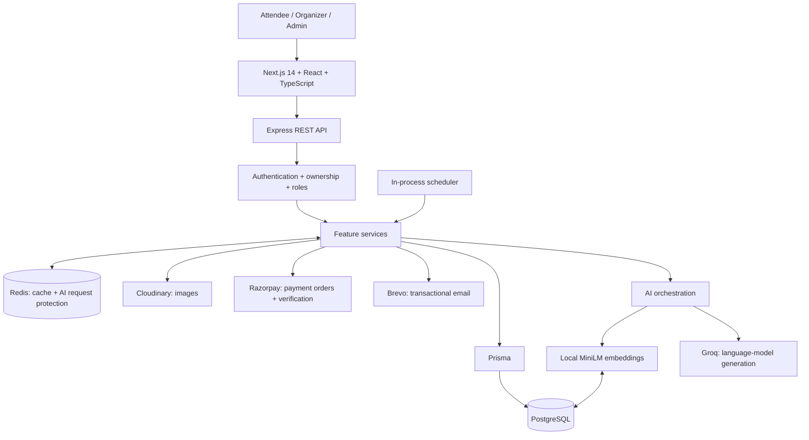
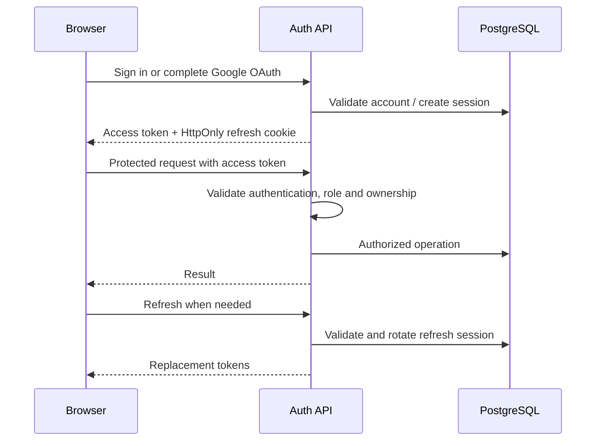
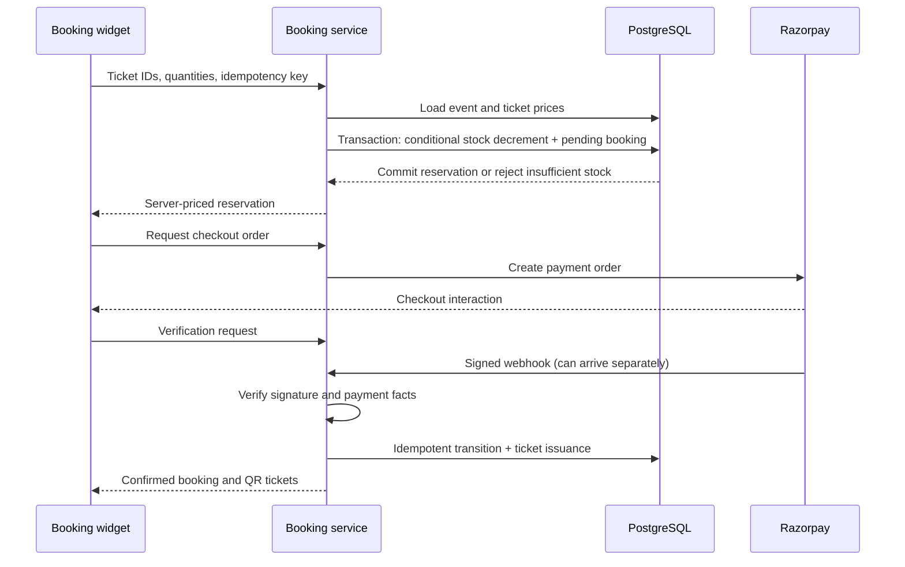
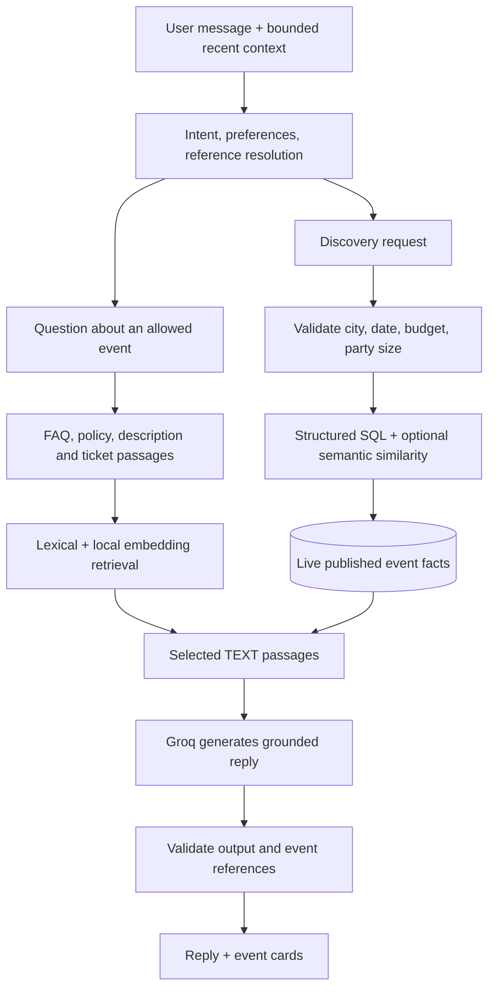
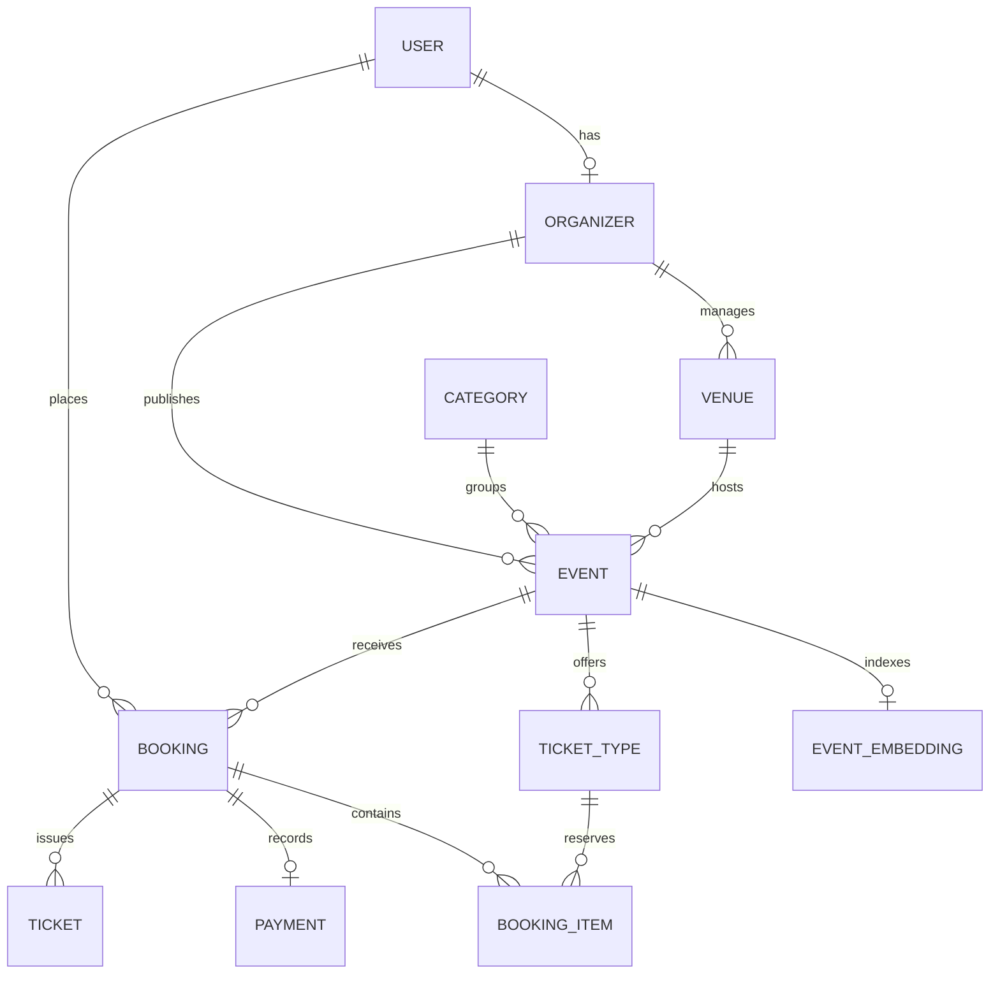

# Architecture and request journeys

This map reflects source structure. It is not a runtime trace or confirmation that every optional hosted service is configured.

## 1. The whole application

The frontend is hosted on Vercel and the API on Render in the project's deployment setup, with PostgreSQL hosted on Neon. Hosting is a deployment choice; PostgreSQL and Express are technologies running inside that setup. Environment settings remain the authority for a particular deployment.

## 2. Repository map

| Location | What to find |
|---|---|
| `apps/web/src/app` | Routes, pages, layouts, server-rendered page loading |
| `apps/web/src/components` | Interactive forms, event cards, booking, chat and dashboards |
| `apps/web/src/lib` | Frontend API clients, authentication and shared helpers |
| `apps/api/src/main.ts` | Backend startup, shared services and scheduler registration |
| `apps/api/src/express/app.ts` | Express middleware, controller construction and route mounting |
| `apps/api/src/express/modules` | HTTP routes/controllers for each feature |
| `apps/api/src/modules` | Business rules, database work, AI, payments and media |
| `packages/database/prisma/schema.prisma` | Tables, relationships, constraints and indexes |
| `packages/validation` | Shared runtime validation schemas |
| `packages/types`, `packages/config` | Shared contracts and configuration |
| `apps/worker/src/index.ts` | BullMQ worker scaffolding, not completed processors |
| `.github/workflows/ci.yml` | Lint, type-check, unit tests, database integration tests and build |

## 3. Discover and related-event prices

1. A page or client component calls the frontend API client.
2. The API parses search filters and pagination.
3. Event search combines parameterized SQL for search/ranking with Prisma hydration.
4. Each summary gets the minimum and maximum **active** ticket prices.
5. The frontend formats paise as INR and renders reusable cards.

Read: [frontend API client](../../apps/web/src/lib/api.ts), [event service](../../apps/api/src/modules/events/events.service.ts), [event card](../../apps/web/src/components/events/event-card.tsx).

Invariant: an absent price must never silently become a free ticket. A genuine active zero-price ticket is different from missing data. Related-event recommendations also need the same summary contract as search results.

## 4. Authentication and authorization

Passwords are hashed with Argon2id. Refresh tokens are opaque values with hashes stored server-side. Read the cookie helper for the precise production flags and cross-origin requirements; do not claim all access tokens are HttpOnly cookies. The browser API helper reads an access token and sends a bearer header.

Read: [auth service](../../apps/api/src/modules/auth/auth.service.ts), [Google OAuth](../../apps/api/src/modules/auth/google-oauth.service.ts), [auth middleware](../../apps/api/src/express/middleware/auth.ts), [browser auth client](../../apps/web/src/lib/auth.ts).

Interview distinction: authentication answers “who are you?”; authorization answers “may you do this to this resource?” Hiding a button does not enforce authorization.

## 5. Booking, inventory and payment

Key implementation points:

- Prices are integer paise, loaded from the database, not accepted from the client.
- Duplicate ticket-type lines are combined before inventory work.
- The transaction conditionally decrements only if enough stock remains. A read-then-write check by itself is insufficient under concurrency.
- A pending reservation expires. The scheduler periodically rechecks stale bookings and releases inventory through guarded transitions.
- Browser payment callbacks and provider webhooks can arrive in either order. Confirmation must not issue tickets twice.
- A late payment after expiry is a separate business case; follow the refund workflow rather than assuming it can always reconfirm a closed booking.
- An idempotency key is scoped through ownership checks; it must not expose another user's booking.

Read: [booking widget](../../apps/web/src/components/booking/booking-widget.tsx), [booking service](../../apps/api/src/modules/bookings/bookings.service.ts), [payments](../../apps/api/src/modules/payments/payments.service.ts), [scheduler registration](../../apps/api/src/main.ts), [ticket service](../../apps/api/src/modules/tickets/tickets.service.ts).

Exercise: draw two users competing for the final ticket. Mark the exact database write that decides the winner. Then add a duplicate webhook and explain why there is still one confirmation.

## 6. AI discovery and factual RAG

This is a logical learning map; the orchestration may use an interpretation call before retrieval, and not every greeting needs retrieval or a second generation call.

- The encoder is `Xenova/all-MiniLM-L6-v2`, with normalized 384-dimensional embeddings, executed locally through Transformers.js on CPU.
- Event vectors are stored as PostgreSQL double-precision arrays. Current similarity scoring is not a large-scale indexed vector search engine.
- Event content hashes and timestamps support refreshing changed embeddings and excluding stale versions.
- Factual passages are chunked and selected using lexical scoring and embeddings. The selected **text**, not an array of embedding numbers, provides facts to the language model.
- Recent conversation and compact memory are budgeted separately. RAG does not eliminate conversation management or provider token limits.
- Redis provides shared AI request budgets/concurrency protection. Unlike optional public-read caching, failure of AI protection can cause the AI request to be rejected.
- Groq model profiles are configured by environment, with defaults in the model router. A configured default is not evidence of the exact model used for every live request.
- Recommendations still apply live business constraints. A semantically similar event can be invalid because of its city, date, availability or budget.

Read: [chat UI](../../apps/web/src/components/ai/conversation.tsx), [AI orchestration](../../apps/api/src/modules/ai/ai.service.ts), [semantic retrieval](../../apps/api/src/modules/ai/semantic-retrieval.service.ts), [passage/context helpers](../../apps/api/src/modules/ai/retrieval-context.ts), [event search](../../apps/api/src/modules/events/events.service.ts), [model routing](../../apps/api/src/modules/ai/model-router.ts).

## 7. Core database relationships

This is a simplified subset, not every field or relation. Open the [Prisma schema](../../packages/database/prisma/schema.prisma) for exact cardinalities, uniqueness, status enums and deletion behaviour.

## 8. Runtime versus source map

A module diagram tells you which parts connect. A debugger tells you what actually executes for a particular request, with its arguments and call stack. A visual architecture generated by an AI is a useful draft; compare it against these journeys before using it as an interview claim.
