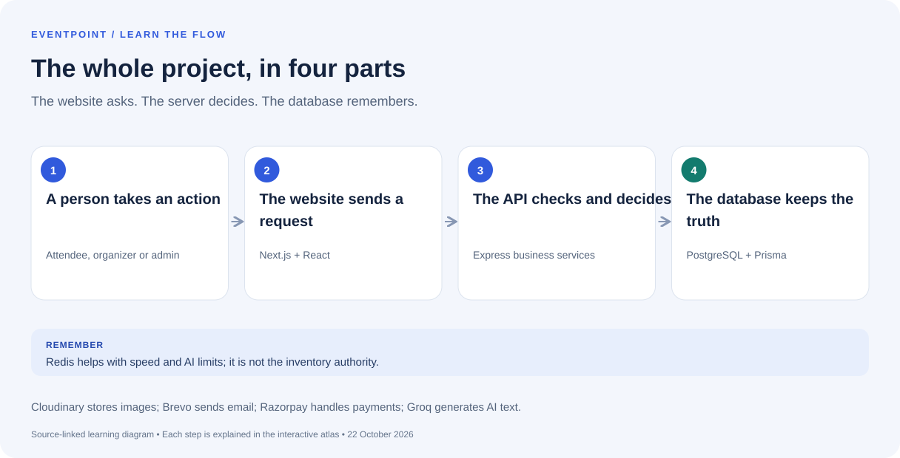
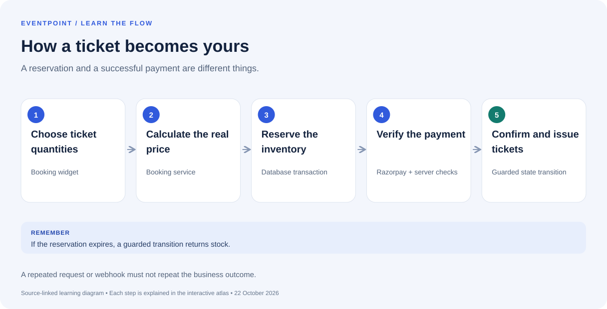
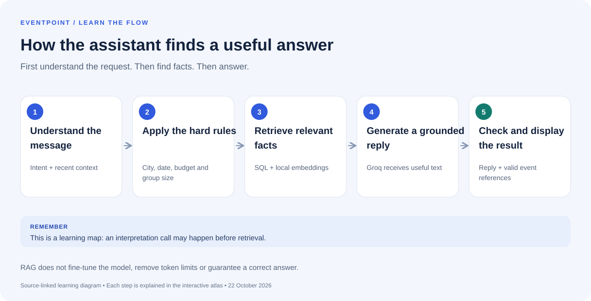

# EventPoint in easy language

## First understand these three jobs

Imagine a cinema booking counter:

- **Frontend = the counter the customer sees.** It collects choices and shows information.
- **Backend = the staff applying the rules.** It checks permission, price, stock and payment.
- **Database = the official records.** It remembers what exists and what happened.

The analogy is just a starting point. The real code involves HTTP requests, database queries and outside providers. A pretty screen does not make an operation valid; the server has to check it.

## One complete example: booking two tickets

1. You choose two tickets on the website.
2. The website sends their IDs and quantities. It also sends a key that identifies this booking attempt.
3. The backend checks the event and loads prices from the database. It does not trust a price typed into a browser request.
4. The database reserves stock and creates a pending booking together.
5. You use the payment provider's checkout.
6. The backend verifies the payment. A successful browser message alone is insufficient.
7. The booking becomes confirmed and tickets are issued once.
8. If the same callback arrives again, the system should recognise that the business action already happened.

**Idempotency** is the word for that last idea: repeat the request without repeating its outcome.

### Why checking stock is not enough

Suppose one ticket remains. Two people both read “1 available” before either writes. A simple earlier check would let both continue. The important operation is a database write that says, in effect: “Decrease stock only if enough still remains.” If the write cannot reserve stock, the booking must not continue as though it succeeded.

**Transaction** means related database changes finish together or are rolled back together. **Concurrency** means requests can overlap in time. These are related but different concepts.

## What every feature does

This catalog complements the detailed source guide; it does not replace it.

| Feature | In plain language | Main code to read | Rule to understand |
|---|---|---|---|
| Homepage and categories | Help a visitor find a direction | `apps/web/src/app/page.tsx`; `modules/categories/categories.service.ts` | Homepage spotlights are selected from eligible categories using paid ticket activity in the 30-day window; category cover/text is configurable. |
| Discover search | Return a manageable page of matching events | `modules/events/events.service.ts`; `app/events/page.tsx` | Filters, ordering, pagination and price fields must agree. |
| Event details and suggestions | Explain one event and show other options | `app/events/[slug]/page.tsx`; event service | Suggestions need valid summaries and real active-ticket minimum prices. |
| Venue browsing and maps | Show where an event is associated and link location information | `modules/venues`; `app/venues` | A map display does not establish an independently confirmed real-world reservation. |
| Saved events | Keep a personal list to revisit | `components/approved/saved-events.tsx`; `lib/favorites.ts` | A saved item still needs current event information when displayed. |
| Login, signup and verification | Establish an account and prove access to it | `modules/auth`; `components/auth` | Password hashing, verification, access tokens and refresh tokens do different jobs. |
| Organizer application | Request permission to host events | `express/services/moderation.service.ts` | Creating an account does not automatically grant approved organizer privileges. |
| Event creation and ticket inventory | Set up an event and the ticket types it sells | `components/organizer/event-form.tsx`; modules/events and tickets | Organizer ownership and publication/moderation rules are server-side concerns. |
| Media and category covers | Upload and reuse appropriate hosted images | `modules/events/event-media.service.ts`; `components/admin/category-manager.tsx` | Image appearance, asset ownership and upload/provider limits are separate concerns. |
| Booking | Reserve quantities while payment is pending | `modules/bookings/bookings.service.ts` | Stock, price, expiry and idempotency must remain correct. |
| Payment and refunds | Verify payment and handle reversals | `modules/payments/payments.service.ts` | Duplicate, delayed or failed provider messages must not corrupt state. |
| Tickets and admission | Give a booked attendee a ticket and validate its use | `app/tickets`; `app/dashboard/scan` | Reading a QR is not enough; the backend decides whether admission is valid. |
| Calendar and personal dashboard | Present a user's plans and activity | `app/calendar`; `app/overview` | The display is a view of records, not another source of truth. |
| Organizer analytics | Summarise an organizer's activity | `app/organizer/analytics`; approved overview/chart components | Label exactly what each count measures; do not mix bookings, tickets and money. |
| Notifications and email | Tell users about relevant changes | `components/notifications`; `modules/notifications` | In-app state and external email delivery can fail independently. |
| Admin review | Review applications and submitted events | `app/admin/page.tsx`; admin and moderation services | Role checks, ownership rules, pending counts and review outcomes must be consistent. |
| System controls and team | Manage availability and administrative access | admin/system-controls service; admin/team components | Only authorized accounts should make administrative changes. |
| AI discovery | Turn an uncertain preference into suitable options | `modules/ai/ai.service.ts`; event service | Ask for clarification when necessary and apply real catalog constraints. |
| Factual RAG | Find the right event passages before answering | `semantic-retrieval.service.ts`; `retrieval-context.ts` | Retrieved evidence must be relevant, current and tied to an allowed event. |
| Caching and request protection | Avoid repeated work and bound AI usage | `common/cache/cache.service.ts`; `express/middleware/ai-guard.ts` | Speed improvements must not become the authority for money or inventory. |
| CI, hosting and monitoring | Check revisions and operate the application | `.github/workflows/ci.yml`; `src/main.ts`; deployment docs | Source correctness, deployment completion and runtime health are different observations. |

Backend paths in the table are relative to `apps/api/src`; frontend paths are relative to `apps/web/src` unless a full path is shown.

## AI explained without the confusing words

You say: “I want a calm event in Delhi below ₹1,000.”

1. The system interprets what you mean. It may ask a follow-up if something important is unclear.
2. City, budget, date and group size become rules that candidate events must satisfy.
3. A local model can turn text into a list of numbers called an **embedding**. Similar meanings tend to get more similar representations.
4. Those numbers help find relevant events or passages. They do not contain a magically readable answer for Groq.
5. Relevant **text and facts** supply useful context for the language model.
6. The application checks the resulting response and event references before displaying them.

This is the central idea of **retrieval-augmented generation (RAG)**: find relevant information, then use it to support an answer. It does not mean retraining the language model, sending the full database every time, or removing all limits.

## More words made simple

| Word | Easy meaning | Example here |
|---|---|---|
| Request | One message asking a server to do something | “Show the next page of Delhi music events.” |
| Response | The server's reply | A page of event summaries or an error. |
| Endpoint | A named API address for a job | An event detail or booking endpoint. |
| Validation | Check the shape and allowed values of input | Quantity must be a supported positive number. |
| Authorization | Check whether this person may do the job | An organizer cannot edit someone else's event. |
| Foreign key | A link between database records | A booking points to its user and event. |
| Index | A database aid for finding records efficiently | An index on frequently filtered event fields. |
| Cache | A temporary reusable copy | A short-lived event response. |
| Invalidation | Stop using an old cached copy | Event edits invalidate related cached reads. |
| Race condition | Overlapping work makes the result depend on timing | Two requests try to buy the last ticket. |
| Webhook | An outside service sends the server an update | A payment provider reports a payment event. |
| Hash | A one-way representation for comparison | Password hashing and content-change detection have different requirements. |
| Signature | A check that data came from someone holding a secret/key | Verify a payment message. |
| SSR | Build page output on the server | Server-loaded event pages in Next.js. |
| Client component | Interactive UI code that can use browser state | Chat input and ticket quantity controls. |
| Fallback | A planned response when the preferred path is unavailable | Keyword retrieval when semantic inference is unavailable. |

## How to explain one file

Do not begin by reading every import aloud. Say: “This file handles **this job**. It receives **this input**, checks **these rules**, uses **this data/provider**, and returns **this result**. This is what it does if something goes wrong.” Then show the small part of the code that proves it.

All the original technical guides remain available for the details behind these simple explanations.
