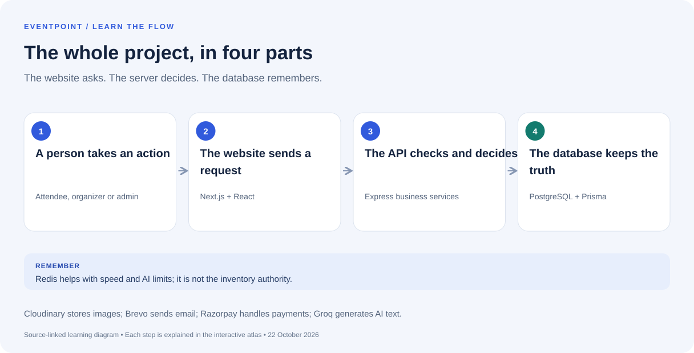
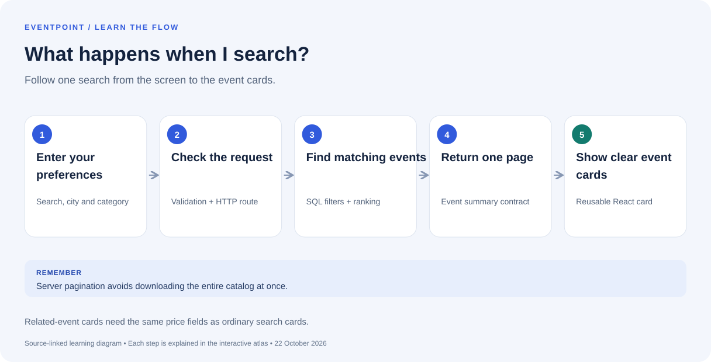
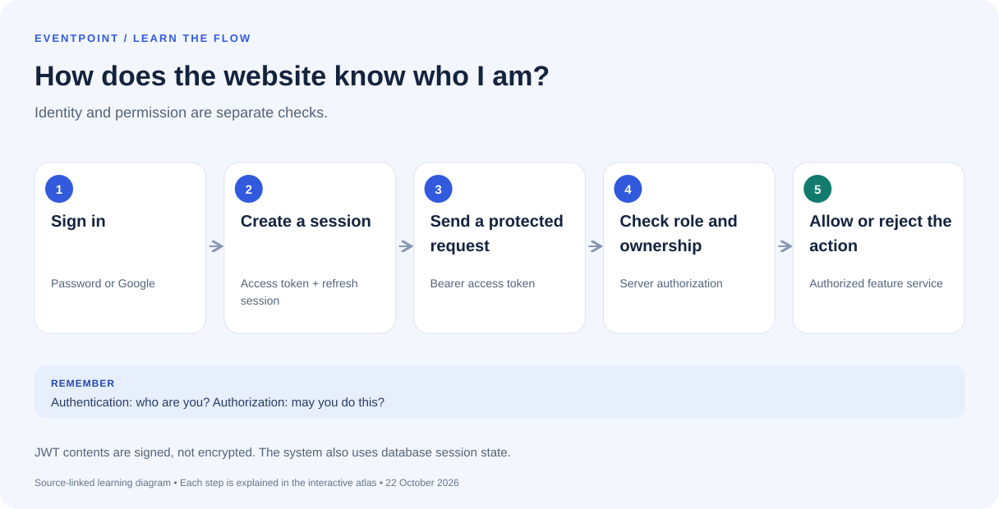
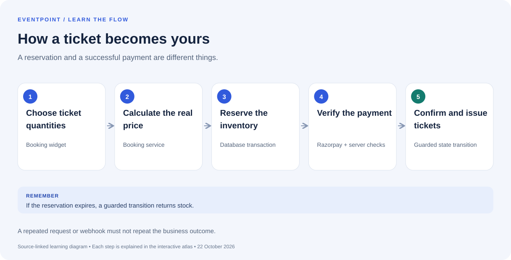
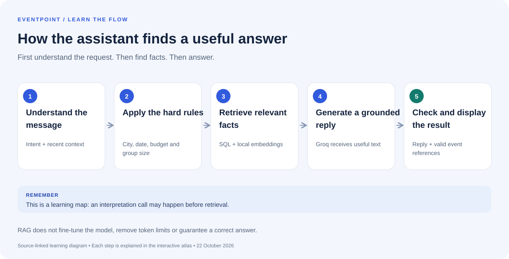
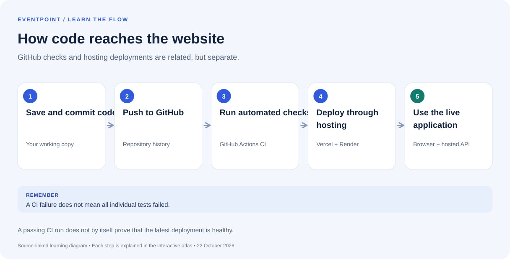

# EventPoint visual journeys

Start with the big picture. Then follow one action at a time. Each numbered box has one job; arrows show the simplified order. These are source-grounded explanations, not recordings of live requests.

For clickable step explanations and source links, download the repository and open [index.html](index.html). For editable shapes, open [the tldraw board](https://www.tldraw.com/f/RNvB-ohzBfBU19zsxH5is).

## 1. The big picture

## 2. Search for events

## 3. Login and permissions

## 4. Book and pay

## 5. Ask the AI assistant

## 6. Deliver the application

Continue with the [full architecture and sequence diagrams](architecture-and-flows.md), [technology choices](technology-choices.md) and [interview roadmap](interview-roadmap.md). Original detailed explanations remain available alongside these simpler maps.
