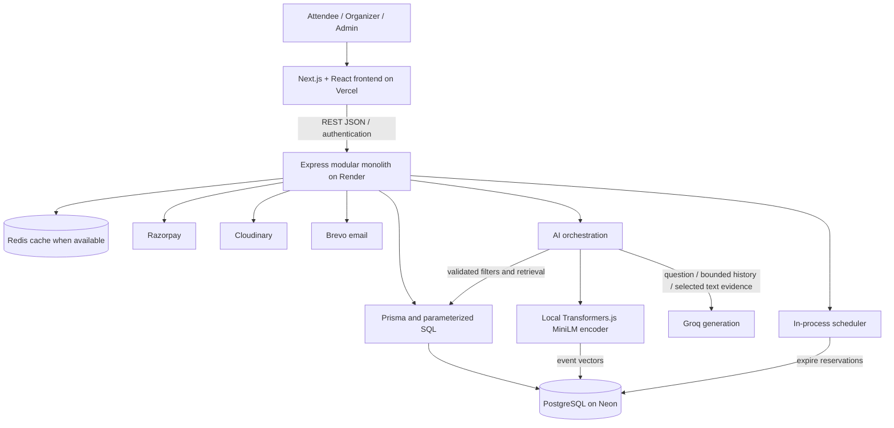
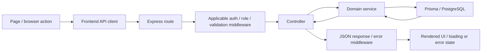
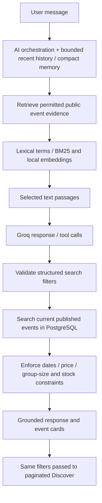
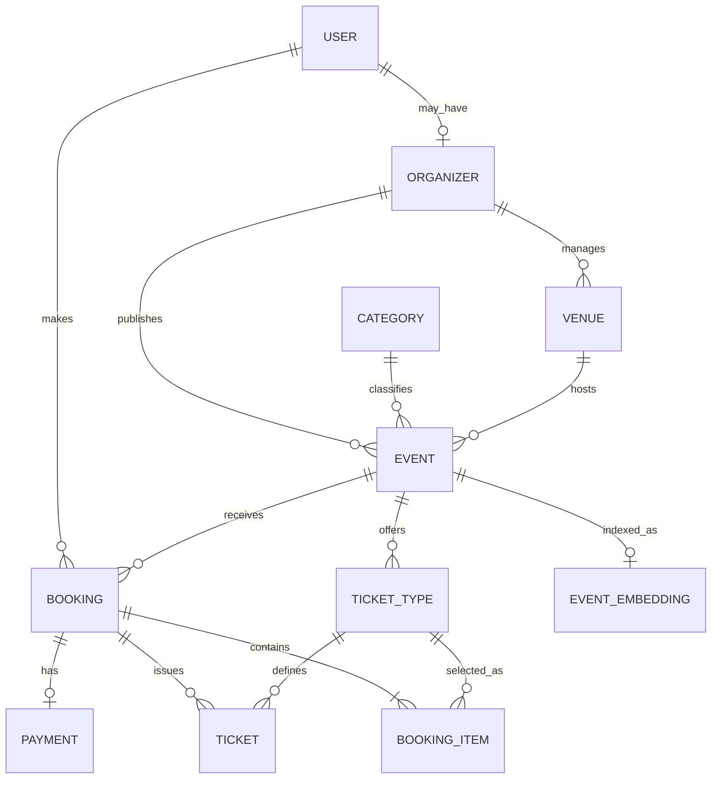
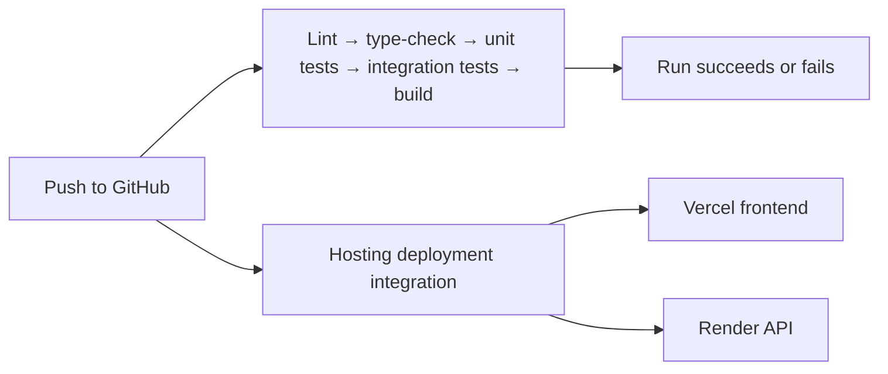

# Architecture and feature flows

These are explanatory maps based on the source. Arrows show logical communication; they are not measured production traces.

## 1. System overview



The frontend has both server-rendered pages and browser components. Consequently, an API request may originate from a Next.js server render or directly from the browser. Redis is an optional acceleration/failure boundary, not the authoritative inventory store. The worker skeleton is deliberately omitted from the active-processing diagram.

## 2. One ordinary request



Public reads do not all require login; protected writes require server checks. A TypeScript type is not a runtime security boundary.

## 3. Booking and payment

```mermaid
sequenceDiagram
    participant B as Browser
    participant A as Express API
    participant D as PostgreSQL
    participant R as Razorpay
    B->>A: Reserve ticket type and quantity, idempotency key
    A->>D: Read authoritative price; guarded inventory decrement in transaction
    D-->>A: PENDING booking with expiry, or reject unavailable stock
    A-->>B: Booking ID and server-computed amount
    B->>A: Request payment order for booking
    A->>R: Create/reuse payment order
    R-->>A: Provider order information
    A-->>B: Checkout information
    B->>R: Complete checkout
    B->>A: Submit checkout verification fields
    R->>A: Signed payment webhook may arrive separately
    A->>A: Verify signature and reconcile current booking/payment state
    A->>D: Idempotent confirmation and ticket issuance
    A-->>B: Confirmed booking and ticket access
```

Important branches:

- Checkout callback and webhook can race or repeat. The network does not promise exactly-once delivery.
- Reservation expiry releases inventory through guarded database state changes.
- A late payment for a closed booking must not simply issue tickets against released inventory; inspect the late-capture/refund path.
- The browser does not decide the price. Prices are integer paise in storage: 69900 means ₹699.
- Showcase bookings intentionally use simulated internal payment records. They do not represent Razorpay charges.

Source: [BookingsService](../../apps/api/src/modules/bookings/bookings.service.ts), [PaymentsService](../../apps/api/src/modules/payments/payments.service.ts), [booking widget](../../apps/web/src/components/booking/booking-widget.tsx).

## 4. AI and RAG



### What an embedding is

An embedding is a numerical representation that helps compare the meaning of text. This project uses a pretrained 384-dimensional MiniLM sentence encoder locally. It does not train its own foundational model.

### Two retrieval paths to distinguish

1. **Event discovery:** store embeddings of event descriptions and metadata in PostgreSQL arrays. Apply structured constraints and compare normalized query/event vectors using exact similarity scoring. Current event ranking combines relevance with paid ticket counts and deterministic tie-breaking.
2. **Passage evidence:** split selected event descriptions, policies, ticket descriptions and FAQs into passages. Lexical scores select candidates; semantic similarity and lexical ranking combine through reciprocal rank fusion. Select a small evidence set for the prompt, including multiple events when comparing.

The passage candidate limit means this is not an exhaustive dense-vector search over every sentence in the entire catalog. Understand that trade-off rather than describing a different implementation.

### What actually goes to Groq

The message, bounded conversational context, instructions/tool definitions and selected **readable event text/facts**. Numeric embedding arrays are used for retrieval, not substituted for the text the LLM needs to answer.

RAG can reduce unnecessary prompt context, but it does not eliminate token limits, provider quotas, latency or hallucinations. Local encoding also consumes CPU and memory. Retrieval freshness uses source hashes/timestamps; unavailable semantic inference falls back to keywords instead of silently claiming semantic success.

Source: [AiService](../../apps/api/src/modules/ai/ai.service.ts), [SemanticRetrievalService](../../apps/api/src/modules/ai/semantic-retrieval.service.ts), [retrieval-context](../../apps/api/src/modules/ai/retrieval-context.ts), [model router](../../apps/api/src/modules/ai/model-router.ts).

## 5. Core data relationships



This is the principal conceptual model. Optionality of newly created records depends on the workflow; the Prisma schema is authoritative. In particular, an unconfirmed booking may have no issued ticket and a booking may not yet have a payment record.

## 6. Delivery and CI



The hosting integration and GitHub check are distinct systems. Inspect their actual settings/statuses before claiming CI gates a deployment. A red combined job does not prove all tests failed, and a green build does not prove payment/provider flows work in production.
