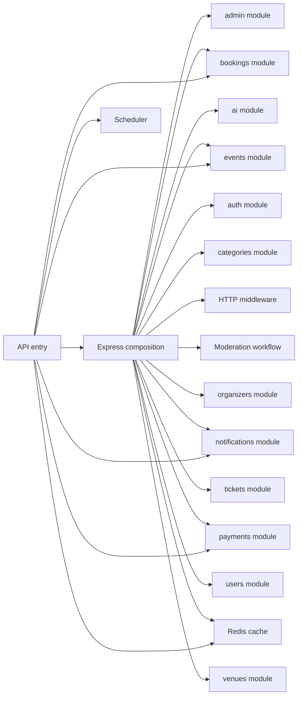
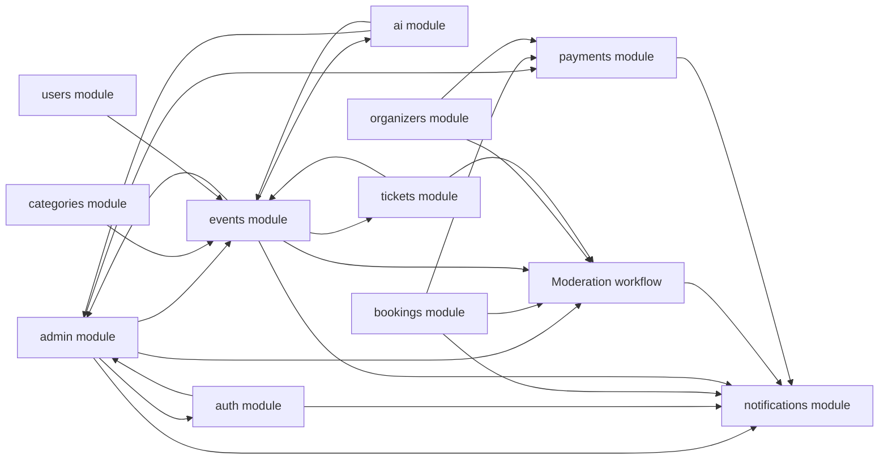

# Generated API import map

Generated from the reachable imports of apps/api/src/main.ts.

70 API source files were read. Arrows mean grouped source imports, including type imports; they are not runtime calls, HTTP requests or database relationships. External packages and generic runtime helpers are omitted for readability.

## Entry-point composition

## Cross-module dependencies

## Extracted relationships

| From | Imports | Import statements |
|---|---|---:|
| admin module | auth module | 1 |
| admin module | events module | 1 |
| admin module | HTTP middleware | 1 |
| admin module | Moderation workflow | 1 |
| admin module | notifications module | 1 |
| admin module | payments module | 1 |
| admin module | Redis cache | 1 |
| ai module | admin module | 1 |
| ai module | events module | 1 |
| ai module | HTTP middleware | 1 |
| ai module | Redis cache | 1 |
| API entry | bookings module | 1 |
| API entry | events module | 1 |
| API entry | Express composition | 1 |
| API entry | notifications module | 1 |
| API entry | payments module | 1 |
| API entry | Redis cache | 1 |
| API entry | Scheduler | 1 |
| auth module | admin module | 1 |
| auth module | HTTP middleware | 1 |
| auth module | notifications module | 1 |
| bookings module | HTTP middleware | 1 |
| bookings module | Moderation workflow | 1 |
| bookings module | notifications module | 1 |
| bookings module | payments module | 1 |
| categories module | events module | 2 |
| categories module | HTTP middleware | 1 |
| categories module | Redis cache | 1 |
| events module | admin module | 1 |
| events module | ai module | 1 |
| events module | HTTP middleware | 1 |
| events module | Moderation workflow | 1 |
| events module | notifications module | 1 |
| events module | Redis cache | 1 |
| events module | tickets module | 1 |
| Express composition | admin module | 5 |
| Express composition | ai module | 4 |
| Express composition | auth module | 5 |
| Express composition | bookings module | 3 |
| Express composition | categories module | 3 |
| Express composition | events module | 4 |
| Express composition | HTTP middleware | 6 |
| Express composition | Moderation workflow | 1 |
| Express composition | notifications module | 3 |
| Express composition | organizers module | 3 |
| Express composition | payments module | 3 |
| Express composition | Redis cache | 1 |
| Express composition | tickets module | 3 |
| Express composition | users module | 3 |
| Express composition | venues module | 3 |
| HTTP middleware | admin module | 1 |
| HTTP middleware | Redis cache | 1 |
| Moderation workflow | notifications module | 1 |
| organizers module | HTTP middleware | 1 |
| organizers module | Moderation workflow | 1 |
| organizers module | payments module | 1 |
| payments module | HTTP middleware | 1 |
| payments module | notifications module | 1 |
| tickets module | events module | 1 |
| tickets module | HTTP middleware | 1 |
| tickets module | Moderation workflow | 1 |
| users module | events module | 4 |
| users module | HTTP middleware | 1 |
| venues module | HTTP middleware | 1 |
